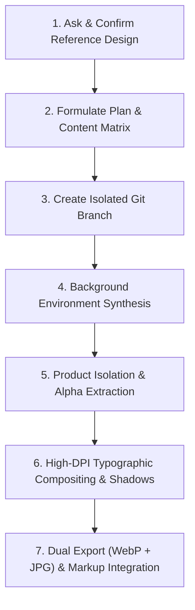

# Bulk Design Editing & Poster Generation Workflow

This workflow governs all bulk design editing, product card updates, and marketing poster generation tasks across the codebase.

## Mandatory Rule: Reference Design First

> [!IMPORTANT]
> **NEVER** initiate bulk design generation or card editing without an approved visual reference design.
> 
> Before writing any code or generating imagery, always ask the user for a reference design:
> 1. An uploaded reference image (e.g. brochure, poster, catalog layout).
> 2. A pointer to an existing approved design/asset in the repository.
> 3. An approved AI-manipulated mock or style prototype.

---

## The 7-Stage Execution Pipeline

### Stage 1: Reference Acquisition & Style Deconstruction
- Analyze the user's reference design for:
  - **Typographic hierarchy**: Headlines, category badges, accent lines, tracking, and alignment.
  - **Lighting & Atmosphere**: High-key vs. low-key, depth of field, ground reflection, environmental context.
  - **Graphic Accents**: Diagonal ribbons, chevron bars, hash marks, framing borders.
  - **Product Staging**: 3/4 perspective, scale ratio, ground contact shadows.

### Stage 2: Content Matrix & Plan Approval
- Define exact, verified technical copy for every single card before touching assets:
  - Card ID / Filename
  - Primary Display Headline (2–3 lines uppercase)
  - Sub-label / Classification
  - Certification or Standard Pill Badge
  - Target Hardware Description
- Present this plan artifact to the user and request approval (`RequestFeedback: true`).

### Stage 3: Branch Isolation
- Never work directly on `main` for bulk design changes.
- Checkout an isolated feature branch (e.g., `git checkout -b <feature>-poster-cards`).

### Stage 4: Background Environment Synthesis
- Generate or render the architectural backdrop plate independently:
  - Maintain brand-specific color palette (e.g., APS Navy `#0D1E3D`, APS Gold `#B8962E`, Inox White `#F5F5F3`).
  - Keep the foreground floor spacious and clear of clutter.
  - Ensure soft background depth of field (blurred plant machinery / cleanroom interior).
  - Do not burn text or logos directly into the background plate.

### Stage 5: Product Isolation & Fidelity Preservation
- **Zero Mechanical Distortion Guarantee**:
  - Never allow raw AI generation to hallucinate or warp industrial machinery.
  - Isolate authentic hardware photos or high-fidelity studio renders on solid pure white (`#FFFFFF`) backgrounds.
  - Use edge-connected flood-fill algorithms for alpha extraction:
    - Never delete white specular highlights inside polished stainless steel, chrome, or glass.
    - Transition floor thresholds smoothly to remove studio ground shadows while preserving contact bolts, feet, and flanges.

### Stage 6: High-DPI Typographic Compositing
- Use programmatic compositing (Python Pillow / Canvas) for pixel-crisp vector rendering:
  - Enforce **10% safe margin zones** on all borders to guarantee mobile/carousel responsive safety.
  - Overlay official high-res brand logos (`aps_logo.png`).
  - Synthesize realistic multi-layered ambient occlusion ground shadows under the equipment.
  - Render crisp, antialiased display typography, gold accent dividers, and pill badges.
  - Add signature brand accents (e.g., 5-bar gold hash marks `/////`).

### Stage 7: Dual Export & Markup Integration
- Export each poster card in both:
  - Modern optimized `.webp` (quality 92–94)
  - High-compatibility `.jpg` (quality 94–95)
- Integrate into HTML using responsive `<picture>` tags with explicit width/height and descriptive `alt` tags.
- Ensure container CSS has `.spares-img-wrap picture { display: contents; }` to maintain zoom/hover interactions seamlessly.
- Run local build (`npm run build`) and verify responsive behavior across all viewports.
